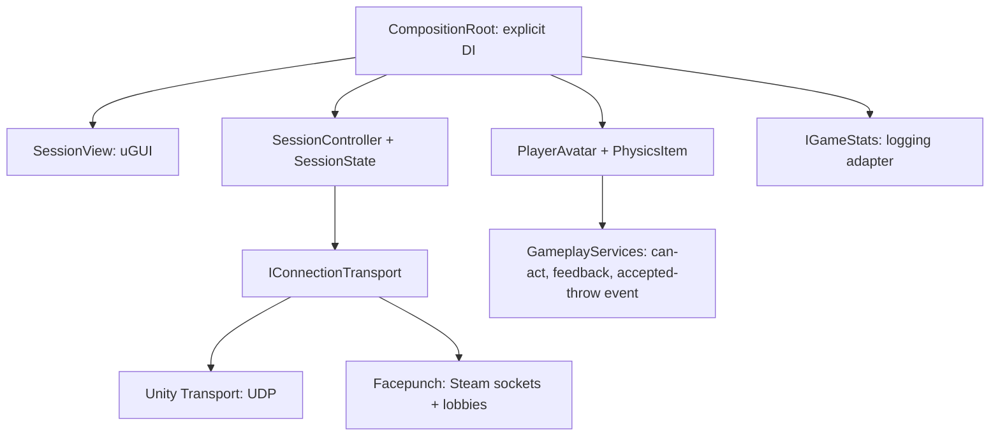

# Dock Co-op

A 2–4 player Unity physics prototype for the ArtDock network developer assignment. The player's host process owns the session and simulates the world. No backend subscription is required.

## Run

Open with **Unity 6000.3.21f1 LTS**, open `Assets/Coop/Generated/Menu.unity`, and press Play. Packages are pinned in `Packages/packages-lock.json`. The checked-in scenes and prefabs are ready; `Coop > Generate project assets` regenerates them from the small editor builder. `Coop > Build Windows` creates `Builds/Windows/DockCoop.exe` (development build, useful for diagnostics).

Windows build: extract the whole archive, keep the data and DLL folders alongside the executable. Host starts a lobby, clients join, then the host clicks **Start game**. A late joiner joins the same address while the session is playing.

```powershell
.\DockCoop.exe --host --profile host --name Alice --port 7777
.\DockCoop.exe --join --profile client1 --name Bob --address 127.0.0.1 --port 7777
.\DockCoop.exe --join --profile client2 --name Carol --address 127.0.0.1 --port 7777
```

Without `--host` / `--join`, use the menu. Each `--profile` has a separate persistent local GUID; the same profile deliberately fails duplicate-player approval. On two PCs use the host's LAN IPv4 address and allow the executable/UDP port through Windows Firewall. Across the public Internet direct UDP requires host port forwarding and a reachable address; Steam mode provides relay connectivity without that setup. No claim of a public two-PC test is made in the local verification report.

Steam: start with `--transport steam`, host a friends-only lobby, share its displayed ID or use **Invite Steam friends**. `--private` creates a private lobby; `--lobby-name "Test room"` names it. See [Steam setup and verification limits](docs/STEAM.md). The default UTP mode works without Steam or a second Steam account.

| Input | Action |
|---|---|
| WASD / mouse / Space | Move / look / jump |
| F | Ask host to spawn an item |
| E | Grab aimed item / drop held item |
| Right mouse / X | Throw / delete held item |
| C | Change replicated character colour |
| Tab or Escape | Player list, RTT, host kick, leave; toggle cursor |

Host capacity can be set with `--max-players 2`, `3` or `4` (default `4`), for both UTP and Steam lobbies. The host replicates the chosen limit to the UI.

## Architecture



Gameplay never imports UTP or Steam. The composition root selects an adapter once, injects services into newly spawned avatars, and wires disconnect cleanup. There is no reflection container or hidden service lookup; the static spawn event is only a composition notification. Session policy and the initial loading barrier are plain C# with executable tests.

Add a transport by implementing `IConnectionTransport` (including identity validation) and selecting it in `CompositionRoot`. Add a new item by registering its network prefab and extending the host's item creation policy; preserve server simulation and validation. The current prototype intentionally has one item type.

## Network decisions

- **30 Hz NGO tick; 50 Hz host physics.** Transform deltas use 2 cm / 1 degree thresholds, unreliable sequenced updates with NGO recovery, interpolation on replicas, no scale synchronization. Aim pitch is sent at most 10 Hz; roster RTT is refreshed once per second. This is a configuration description, not a measured bandwidth claim.
- **Owner-authoritative character.** Immediate local movement makes the controller responsive without prediction/reconciliation complexity. Remote motion is interpolated. Cooperative trust is explicit: host item validation uses the host's observed player position, and does not prevent a modified owner from teleporting inside the permitted area.
- **Host-authoritative items.** Only the host spawns, destroys and simulates bodies. Grab changes NGO ownership to the holder but never moves physics authority off the host. Release returns ownership to the host and applies one authoritative velocity. Clients interpolate; they never independently predict landing.
- **Validated actions.** RPC sender must own the player, be ready in the active scene, and have a finite in-bounds pose. Host checks distance, line of sight for grab, item existence, free/held state and exact holder. Serial host execution makes a competing grab atomic. Spawn/action limits bound accidental flooding; at most 40 items exist.
- **Persistent state.** Holder ID, held item ID, colour, roster and scene phase are replicated state, not replay-only RPCs, so late join observes the current result. Items survive creator/holder disconnect; held items are released and fall.
- **Connection lifecycle.** Approval reserves slots before synchronization and checks protocol version, player count and duplicate identity. UTP GUIDs are identifiers, not authentication; Steam binds identity to its authenticated transport peer. Initial scene participants share a future server-time release after everyone loads. Disconnect removes the participant from the barrier. Late joiners synchronize independently, without pausing incumbents. Loading/connection timeouts and host loss return an explanatory menu; no host migration.
- **Stats.** The host acknowledges an accepted throw only to its owner. That local account records the event through `IGameStats`; the provided logging adapter batches `Flush` on leave/quit, avoiding accidental attribution of every player's throw to the host. No real Spacewar achievements are written.

See [gameplay detail](docs/GAMEPLAY.md) and [decisions](docs/DECISIONS.md).

**Windows transport fix:** the embedded Unity Transport 2.7.4 includes a one-line backport for an upstream-confirmed failed-receive buffer leak. Without it, forcibly closing a client on Windows could exhaust the host's UDP receive pool and disconnect survivors. [Patch provenance](Packages/com.unity.transport/UPSTREAM-PATCH.md) and [debugging evidence](docs/NETWORK-DEBUGGING.md) explain the change. It requires no firewall workaround.

## Verification and limitations

```powershell
dotnet run --project tools/tests/SessionPolicy.Tests.csproj
powershell -ExecutionPolicy Bypass -File tools/verify-approval.ps1
python tools/udp_proxy.py --listen 7778 --target 7777 --delay-ms 75 --jitter-ms 15 --loss .03
# One client joins port 7778 through this proxy; host stays on 7777.
```

Use a separate proxy port/process for each impaired client. Base added RTT is 150 ms, with jitter and 3% loss in each direction. Unity's deprecated `SetDebugSimulatorParameters` is intentionally not used: it has no effect in this package version. The `--smoke` harness drives normal public gameplay requests for build tests; see [verification evidence](docs/VERIFICATION.md) for executed cases and pending manual checks.

Known scope: one arena/item, no persistence across host restarts, no host migration, no competitive anti-cheat or client prediction, no bandwidth measurements yet. Steam code compiles but two separate Steam accounts/PCs are required to validate its live relay, overlay and lobby flows. Exact simultaneous screen changes cannot be guaranteed under arbitrary latency; all initial clients target the same synchronized server timestamp with a 750 ms lead.

## Delivery

Repository history contains implementation and verification commits. Windows archive and demonstration video are local deliverables listed in the verification report. Work was AI-assisted; elapsed implementation/verification time is recorded there; pending manual testing is additional.

Third-party code is limited to Unity networking/input/UI packages and the allowed [community Facepunch transport](https://github.com/Unity-Technologies/multiplayer-community-contributions/tree/main/Transports/com.community.netcode.transport.facepunch). Its pinned source, local patches and licenses are in [UPSTREAM.md](Packages/com.community.netcode.transport.facepunch/UPSTREAM.md). No multiplayer sample/template is used as the project foundation.
