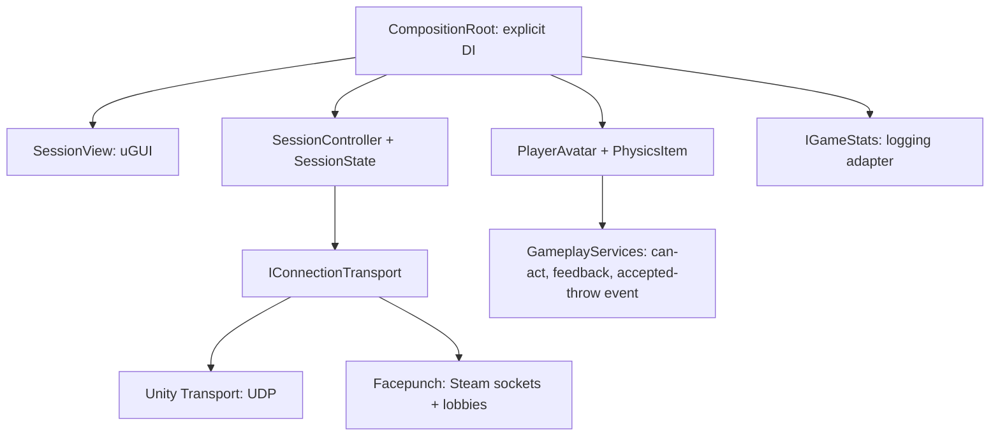

# Dock Co-op

A 2–4 player Unity physics prototype for the ArtDock network developer assignment. The player's host process owns the session and simulates the world. No backend subscription is required.

**[Download v0.1.1](https://github.com/Yurii-Tor/ArtDock-CoopGame-Submission/releases/tag/v0.1.1)** — [Windows x64 ZIP](https://github.com/Yurii-Tor/ArtDock-CoopGame-Submission/releases/download/v0.1.1/DockCoop-Windows-v0.1.1.zip) · [macOS Universal ZIP](https://github.com/Yurii-Tor/ArtDock-CoopGame-Submission/releases/download/v0.1.1/DockCoop-macOS-v0.1.1.zip) · [SHA-256 checksums](https://github.com/Yurii-Tor/ArtDock-CoopGame-Submission/releases/download/v0.1.1/SHA256SUMS.txt). **Unity is not needed to run these builds.** Extract the whole ZIP and keep its files together. macOS requires version 12 or newer; the app supports Intel and Apple Silicon.

**[Watch the submission demo](https://github.com/Yurii-Tor/ArtDock-CoopGame-Submission/releases/download/v0.1.1/DockCoop-Submission-v0.1.1.mp4)** — Windows local UTP with three game windows (one host and two clients), followed by a Steam invitation and shared gameplay on Windows and macOS.

## Quick start: one Windows PC, no Steam

1. Run **`Host-Local.cmd`**, then **`Client-1-Local.cmd`** from the extracted Windows folder. Optionally run **`Client-2-Local.cmd`** for a third player.
2. Confirm the players appear in the host's roster, then click **Start game** on the host. Each launcher uses a different `--profile`; all connect locally to `127.0.0.1:7777` using Unity Transport (UTP).
3. Try the controls below. Start another client after the match begins to test late join. Use **Tab / Escape → Leave** to leave a session.

On one Mac, run **`Host-LAN.command`**, then **`Join-LAN.command`** and press **Enter** to accept `127.0.0.1`. These scripts also use separate profiles. For UTP on two computers on one LAN, enter the host's actual LAN address instead; allow the game and UDP port through the host firewall. `127.0.0.1` refers only to the computer running that copy.

## Quick start: Steam on two computers

Use matching builds on Windows/Windows or Windows/macOS, with **two different Steam accounts added as friends**. Different countries and networks are supported; no VPN, shared LAN, port forwarding or paid backend is required. Keep the bundled **`steam_appid.txt` containing `480`** (Valve's test AppID).

1. Start Steam and sign in on both computers. Choose **Games → Add a Non-Steam Game to My Library → Browse**, then select **`DockCoop.exe`** on Windows or **`DockCoop.app`** on Mac.
2. In the added game's **Properties**, set **Launch Options** to `--transport steam` and **Start in** to the extracted folder containing the executable/app and `steam_appid.txt`.
3. Enable **Steam → Settings → In Game → Enable the Steam Overlay while in-game**. Launch with **Play in the Steam library** and check **Shift+Tab**. On Mac, if Apple cannot verify DockCoop, use **System Settings → Privacy & Security → Open Anyway**, confirm **Open**, then close the game and launch it again from Steam. This development app is not notarized; [Apple describes this per-app approval](https://support.apple.com/en-gb/102445).
4. One player chooses **Host session**. The other stays in the game's main menu. The host presses **Shift+Tab**, right-clicks the friend and selects **Invite to Game**; the friend accepts. Alternatively, the host chooses **Copy lobby ID** and the guest pastes that numeric ID into the lobby/address field before choosing **Join session**. UDP port validation is only used in UTP mode.
5. When both names appear in the roster, the host chooses **Start game**. **Tab / Escape** opens the session panel; only the host can **Kick** a player.

The in-game **Invite Steam friends** button opens Steam's separate invitation dialog. `Steam.cmd` / `Steam.command` select Steam networking directly but do not guarantee an overlay; use the Steam library for invitation testing. Lobby-ID joining works without the overlay. If Steam is unavailable, the menu explains how to start/sign in to Steam or relaunch with `--transport utp`; the game does not silently change transports.

Two-account Windows/Mac gameplay, rejoin, graceful disconnect, **Invite to Game → successful join**, and kick have tester-reported coverage. Two players roughly 1,000 km apart observed about 100 ms RTT in one Steam session; this is application ping/pong RTT including processing time, with no recorded direct/SDR route. See [Steam setup](docs/STEAM.md), the [manual checklist](docs/MANUAL-TESTING.md) and the [dated verification record](docs/VERIFICATION.md).

## Controls

| Input | Action |
|---|---|
| WASD / mouse / Space | Move / look / jump |
| F | Ask host to spawn an item |
| E | Grab aimed item / drop held item |
| Right mouse / X | Throw / delete held item |
| C | Change replicated character colour |
| Tab or Escape | Player list, RTT, host kick, leave; toggle cursor |

Host capacity is **2–4**, default **4**; set `--max-players 2`, `3` or `4`. Steam lobbies are friends-only by default; `--private` creates an invitation-only lobby and `--lobby-name "Test room"` names it. Rendering is capped at 60 FPS when focused and 30 FPS in the background; networking continues while unfocused.

## Architecture



**Netcode for GameObjects (NGO)** manages network object spawning, replicated variables, RPC delivery and network scene synchronization. The chosen transport carries its messages. Our session code adds approval, roster, loading policy and lifecycle; gameplay code adds validated item rules. The host is a **listen server**: the server and its local player run in the same process.

Gameplay imports NGO but never UTP or Steam. The composition root chooses an adapter once, injects services into newly spawned avatars, and wires disconnect cleanup. There is no reflection container or hidden service lookup; the static spawn event is a local composition notification. Session policy and the initial loading barrier are plain C# with executable tests.

Add a transport by implementing `IConnectionTransport` (including identity validation), supplying an NGO `NetworkTransport`, and selecting it in `CompositionRoot`. Add an item by registering its network prefab and extending the host's creation policy while preserving server simulation and validation. The prototype intentionally has one item type.

## Network decisions

- **30 Hz NGO tick; 50 Hz host physics.** Transform deltas use 2 cm / 1 degree thresholds, unreliable sequenced updates with NGO recovery, interpolation on replicas, and no scale synchronization. Aim pitch is sent at most 10 Hz; roster RTT is refreshed once per second. These are configured rates, not measured bandwidth.
- **Owner-authoritative characters.** Immediate local movement keeps control responsive without prediction/reconciliation complexity. Other peers interpolate it. This cooperative prototype trusts movement: item checks use the host's observed player pose and do not stop a modified owner teleporting within the permitted area.
- **Host-authoritative items.** Only the host spawns, destroys and simulates bodies. On grab it separately writes `PhysicsItem.Holder` and `PlayerAvatar.HeldItem`, then calls `NetworkObject.ChangeOwnership`. On release it clears those fields and calls `RemoveOwnership`. Ownership identifies the holder; physics authority remains on the host. A throw applies one host-computed velocity; clients interpolate the result.
- **Validated actions.** The RPC sender must own the player, be ready in the active scene, and have a finite, bounded pose. The host checks reach, line of sight for grab, item existence and exact holder. Sequential host execution allows only the first competing grab to observe a free item. The two replicated fields are a server invariant; their network delivery is not atomic. Request limits bound accidental flooding and at most 40 items exist.
- **Persistent state.** Holder, held item, colour, roster and scene phase are replicated state, so late join observes their current values. Items survive a holder disconnect; a held item is released and falls.
- **Connection lifecycle.** Approval reserves slots before synchronization and checks protocol version, capacity and duplicate identity. UTP GUIDs are identifiers; Steam also binds identity to its authenticated peer. Initial players share a future server-time release after everyone loads. Disconnect removes the player from the barrier. Late joiners synchronize independently without pausing incumbents. Timeouts and host loss return an explanatory menu. The arena may remain behind that menu; a new Host/Join is available.
- **Stats.** After accepting a throw, the host acknowledges only its actor. That client records the event through `IGameStats`; the logging adapter batches `Flush` on leave/quit. No real Spacewar statistics or achievements are written.

See [gameplay details](docs/GAMEPLAY.md) and [decisions](docs/DECISIONS.md). The embedded Unity Transport 2.7.4 has a documented one-line failed-receive buffer leak fix that prevents forcibly closed Windows clients exhausting the host's receive pool: [patch provenance](Packages/com.unity.transport/UPSTREAM-PATCH.md), [debugging evidence](docs/NETWORK-DEBUGGING.md).

## Build and verify from source

Use **Unity 6000.3.21f1 LTS**. Open `Assets/Coop/Generated/Menu.unity` and press Play. Packages are pinned in `Packages/packages-lock.json`; scenes and prefabs are checked in. `Coop > Generate project assets` regenerates them from the editor builder.

```powershell
powershell -ExecutionPolicy Bypass -File tools/build.ps1
dotnet run --project tools/tests/SessionPolicy.Tests.csproj
powershell -ExecutionPolicy Bypass -File tools/verify-approval.ps1
powershell -ExecutionPolicy Bypass -File tools/verify-gameplay.ps1
powershell -ExecutionPolicy Bypass -File tools/verify-host-crash.ps1
powershell -ExecutionPolicy Bypass -File tools/verify-loading-disconnect.ps1
# With Steam running and signed in:
powershell -ExecutionPolicy Bypass -File tools/verify-ui.ps1 -SteamAvailable
# With Steam closed, omit -SteamAvailable to check its unavailable message.
```

The gameplay harness uses separate processes and UDP proxies with 150 ms base added RTT, +/-15 ms jitter per direction and 3% loss per direction. The host-crash probe force-terminates its own host PID after the client reaches gameplay. See [verification evidence](docs/VERIFICATION.md) for actual results and the distinction between model state, rendered UI and manual checks.

For macOS, install **Mac Build Support (Mono)** for the pinned editor, run `tools/build-macos.ps1`, then `python tools/package-macos.py`. Packaging preserves Unix executable permissions. Both release ZIPs include the game, Steam native libraries, launchers, documentation and `BUILD-INFO.txt` with the exact source SHA and Unity version.

UTP command-line equivalents for three local copies:

```powershell
.\DockCoop.exe --host --profile host --name Alice --port 7777
.\DockCoop.exe --join --profile client1 --name Bob --address 127.0.0.1 --port 7777
.\DockCoop.exe --join --profile client2 --name Carol --address 127.0.0.1 --port 7777
```

Each `--profile` has a separate persistent GUID; duplicate profiles deliberately fail approval. Direct UTP across the Internet requires a reachable host UDP address and may require port forwarding. Steam handles Internet connectivity without that setup.

## Known limitations and next steps

- **Unmeasured network behavior:** the selected Steam direct/SDR route, jitter/loss over repeated runs and traffic volume have not been captured. Record networking diagnostics and a bandwidth profile before deciding whether a regional relay would improve the observed ~100 ms RTT experience.
- **Remaining verification:** direct UTP between two physical computers, private-lobby permissions, Steam's separate **Join Game** action, an independent Mac overlay/button check, and a forced host crash with a known Steam build/transport remain unverified. The tester's additional forced-host-close report did not identify transport, build SHA or the displayed reason. Detailed per-control coverage and visual quality under varied connections also remain incomplete. [The verification record](docs/VERIFICATION.md) separates these gaps from implemented behavior.
- **Prototype scope:** one arena/item, no persisted match across restarts, no competitive movement anti-cheat, no client physics prediction, and no Apple notarization. Local UTP and remote Steam play are implemented.

Possible development after this assignment:

1. Measure selected routes, jitter, loss and traffic across repeated runs before considering a regional relay.
2. The match ends when the listen server leaves, as required. Host migration would need a recoverable snapshot, successor selection and restoration of players and held items when clients reconnect.
3. If interaction rules grow, extract server-side validation and item mutations into a module testable outside Unity; RPC handlers would delegate to it.

## Delivery status

The [v0.1.1 release](https://github.com/Yurii-Tor/ArtDock-CoopGame-Submission/releases/tag/v0.1.1) contains the runnable builds and submission video. [Verification and video coverage](docs/VERIFICATION.md#submission-video--6-november-2026) describe the captured scenarios and identify the separate scripted host-crash check.

Work was AI-assisted. The author estimates **4 hours for implementation and review**, plus **2–3 hours for manual testing and network troubleshooting**, about **6–7 person-hours overall**. The historical 1.5-hour initial-stage figure in the verification record is included in that estimate, not an additional total.

Third-party code is limited to Unity networking/input/UI packages and the allowed [community Facepunch transport](https://github.com/Unity-Technologies/multiplayer-community-contributions/tree/main/Transports/com.community.netcode.transport.facepunch). Pinned source, local changes and licenses are recorded in [UPSTREAM.md](Packages/com.community.netcode.transport.facepunch/UPSTREAM.md). No multiplayer sample/template is the project foundation.
